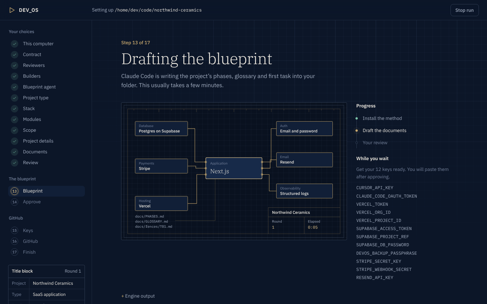
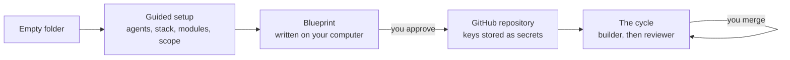
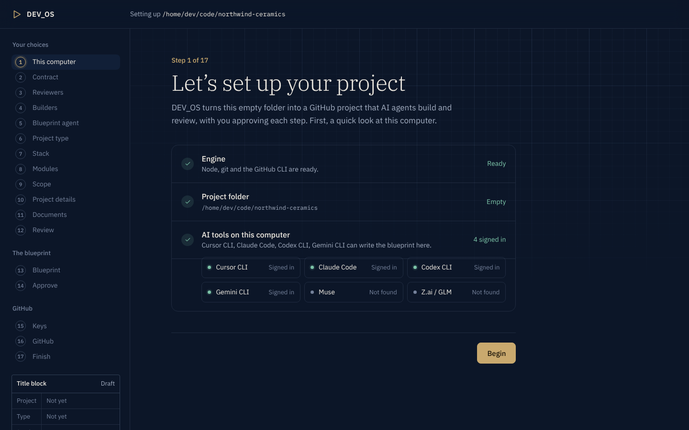
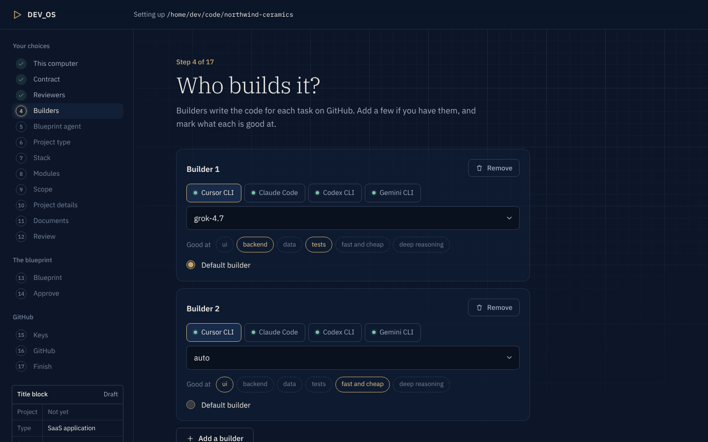
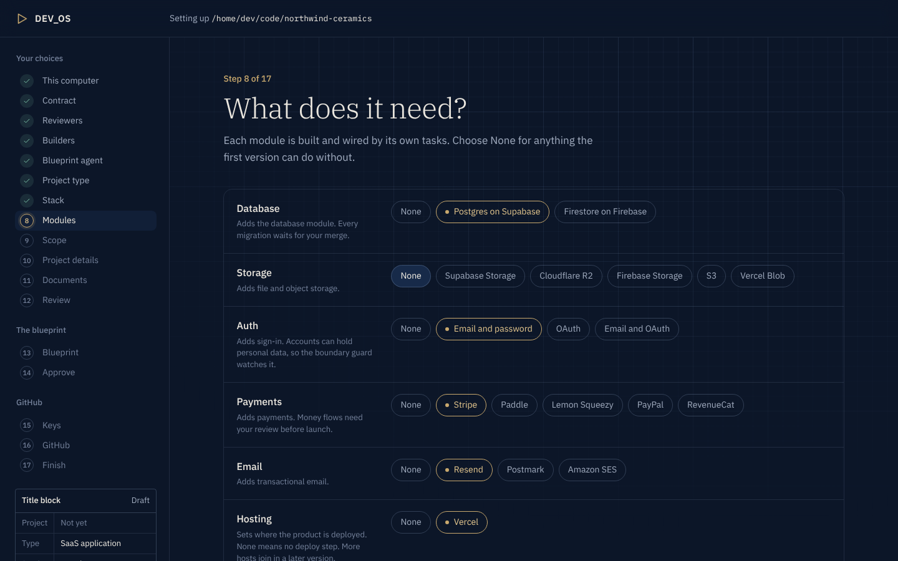
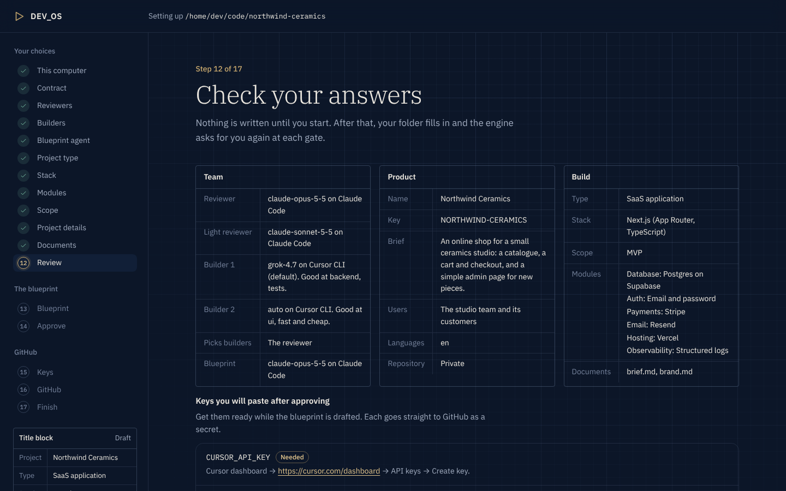
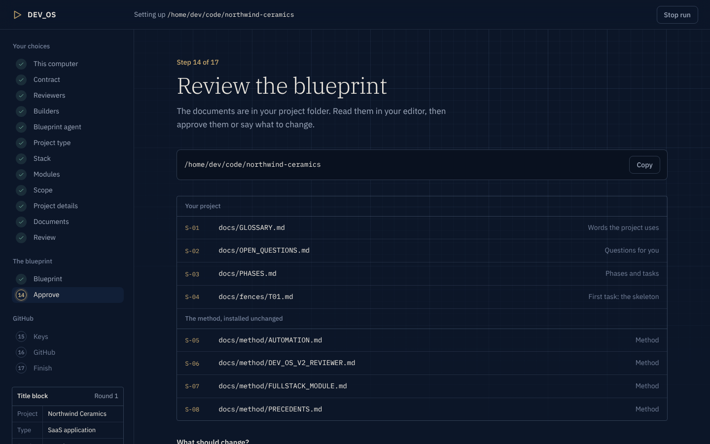
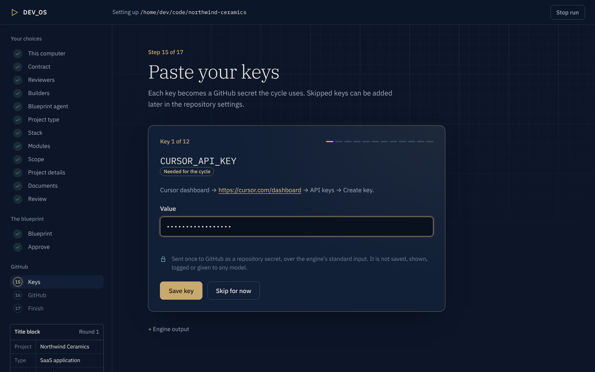
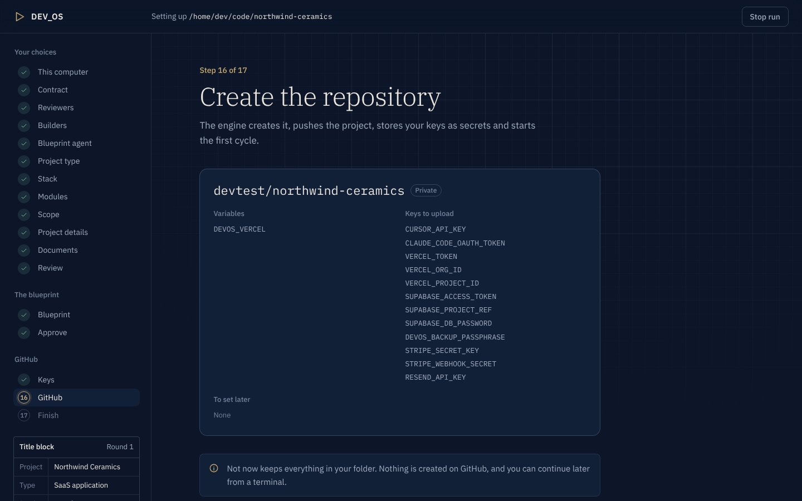
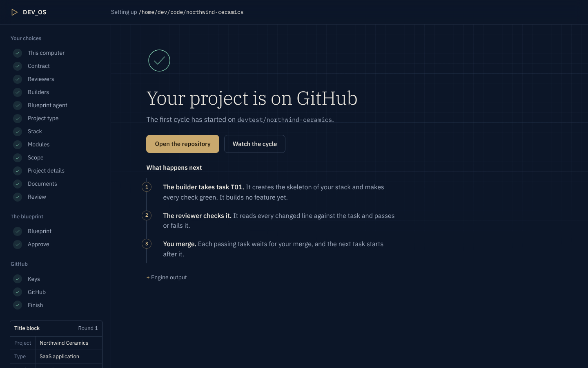

<p align="center">
  <picture>
    <source media="(prefers-color-scheme: dark)" srcset="docs/assets/logo-dark.svg">
    
  </picture>
</p>

<h3 align="center">From an empty folder to a GitHub project that AI agents build, review and ship.<br>You approve every step.</h3>

<p align="center">
  
  
  
  
</p>
<p align="center">
  
  
  
  
</p>
<p align="center">
  
  
  
  
  
</p>

<p align="center">
  <a href="#install">Install</a> &nbsp;·&nbsp; <a href="#create-a-project">Create a project</a> &nbsp;·&nbsp; <a href="#the-guided-setup">Screens</a> &nbsp;·&nbsp; <a href="#commands">Commands</a> &nbsp;·&nbsp; <a href="#roadmap">Roadmap</a>
</p>

<p align="center">
  
</p>

DEV_OS takes you from an empty folder to a GitHub project that AI agents build task by task. You answer a few
questions in your browser or your terminal, and an AI agent on your computer writes the project's blueprint. When you
approve it, DEV_OS creates the GitHub repository and starts the automated cycle on GitHub Actions. From then on, a
builder agent writes each task, a reviewer agent reviews it, and you merge at the gates.

Version `1.4.0`. The engine is under PolyForm Shield 1.0.0 and the files it installs into your project under MIT
(see [Licence](#licence)).

## Why DEV_OS

<table>
  <tr>
    <td width="50%" valign="top"><b>Bring the agents you have.</b> Claude Code, Cursor, Codex and Gemini can each review or build. The reviewer can pick the builder whose strengths fit each task.</td>
    <td width="50%" valign="top"><b>A blueprint you approve.</b> Your agent writes the phases, the glossary and the first task into your folder. You approve them or ask for changes, up to five rounds.</td>
  </tr>
  <tr>
    <td width="50%" valign="top"><b>Gates, not guesses.</b> Every task is reviewed against a written fence, a red check overrides a pass, and nothing merges without you.</td>
    <td width="50%" valign="top"><b>Your keys stay yours.</b> Each key is typed once and handed to <code>gh secret set</code> over standard input. It is never stored, logged or shown to a model.</td>
  </tr>
  <tr>
    <td width="50%" valign="top"><b>Lean by default.</b> Choose an MVP or a full product. The first task builds only the skeleton of your stack and makes every check green.</td>
    <td width="50%" valign="top"><b>Any stack it knows.</b> 16 project types and 20 stacks, from Next.js to FastAPI, Go and Flutter, with modules for data, auth, payments, email and more.</td>
  </tr>
</table>

## How it works



## The guided setup

`Start DEV_OS` (or `devos ui`) opens the setup as a page on this computer. Every screen below is the real page, captured during a test run with stand-in agents.

<table>
  <tr>
    <td width="50%"><br><sub><b>This computer.</b> The engine, the folder and the AI tools signed in here.</sub></td>
    <td width="50%"><br><sub><b>Builders.</b> Pick models, mark what each is good at, choose the default.</sub></td>
  </tr>
  <tr>
    <td><br><sub><b>Modules.</b> A provider for each part of the product, or None.</sub></td>
    <td><br><sub><b>Review.</b> Your answers, and the keys to get ready.</sub></td>
  </tr>
  <tr>
    <td><br><sub><b>Approve.</b> Read the documents in your editor, then approve or ask for changes.</sub></td>
    <td><br><sub><b>Keys.</b> One at a time, hidden, sent straight to GitHub.</sub></td>
  </tr>
  <tr>
    <td><br><sub><b>GitHub.</b> The repository, its variables and the keys to upload.</sub></td>
    <td><br><sub><b>Done.</b> The first cycle has started.</sub></td>
  </tr>
</table>

## What you get

- **Guided setup, in your browser or your terminal.** It covers the contract, the agents and models for each role,
  eight questions about the project, and optional documents for the agent to read.
- **A blueprint written on your computer** by the agent you choose. It covers:
  - the product brief, scope and decisions;
  - the design system;
  - the data model, when the project stores data;
  - the phases, and the first task (fence T01).

  You approve it or describe the changes you want.
- **A GitHub repository with the whole method installed.** That means the workflows, runner scripts, guards, prompts,
  rules, skills and the operating manual. Every file lives in your repository.
- **Keys typed once.** Each key goes straight to GitHub as a secret. DEV_OS never writes one to a file, a log or a
  model.
- **The automated cycle on GitHub Actions.** For each task:
  - the builder works on a branch;
  - the reviewer checks it against the task's fence;
  - checks run, failed attempts retry, and usage limits are waited out.

  You merge the pull requests.
- **What it costs.** Every agent run, from the blueprint to the last review, adds a line with its tool, model and
  tokens. `docs/USAGE.md` totals them by model, by stage and by task. Claude Code reports its own cost; for the other
  tools, set your prices per model once in `devos/prices.json`.

## Requirements

| What | Why | Check |
|---|---|---|
| Node.js 22 or newer | runs the engine (no dependencies) | `node --version` |
| git | the first local commit | `git --version` |
| GitHub CLI, signed in with the `repo` and `workflow` scopes | creates the repository, sets secrets and variables | `gh auth status` |
| One AI coding CLI, signed in on this computer | writes the blueprint | Claude Code `claude`, Cursor CLI `agent`, Codex CLI `codex` or Gemini CLI `gemini` |
| A key for each tool that runs on GitHub | the reviewer and builders run on GitHub Actions | Cursor: `CURSOR_API_KEY` (cursor.com/dashboard → API keys). Claude Code: `CLAUDE_CODE_OAUTH_TOKEN` (run `claude setup-token`) or `ANTHROPIC_API_KEY`. Codex: `OPENAI_API_KEY` (platform.openai.com → API keys). Gemini: `GEMINI_API_KEY` (aistudio.google.com → API keys) |
| Optional: a Vercel account | deploys | `VERCEL_TOKEN`, `VERCEL_ORG_ID`, `VERCEL_PROJECT_ID`, which you can set later |

`devos doctor` checks the GitHub CLI for you. `devos agents detect` shows which AI CLIs are installed and signed in.
[Before you start a project](docs/PROJECT-CHECKLIST.md) lists the rest to prepare: the agents, the project's choices,
its documents, and the services and keys it needs.

## Install

1. **Install the requirements** above. The engine itself needs only Node.js 22 or newer.
2. **Get the engine.** Clone it, or download the ZIP from GitHub and unzip it anywhere:

   ```
   git clone https://github.com/Jovo-Jovi/devos-engine.git
   ```

   Each release is a tag with a GitHub Release and its ZIP; `CHANGELOG.md` says what changed.
3. **Start it.** Nothing else to install: the engine has no dependencies.
   - **Windows:** double-click `Start DEV_OS.cmd` in the engine folder.
   - **macOS:** double-click `Start DEV_OS.command`. The first time, right-click it and choose **Open**.
   - **Any terminal:** open it in the engine folder and run the line for your shell.

     | Shell | Command |
     |---|---|
     | macOS or Linux | `./devos ui` |
     | Windows PowerShell | `.\devos ui` |
     | Windows Command Prompt | `devos ui` |
     | Any shell | `node bin/devos.mjs ui` |

   The guided setup opens in your browser. Keep the window that opened with it until the setup is done.

- **Where projects go.** Each project gets its own new folder, outside the engine folder. The page suggests
  `devos-projects` in your home folder. DEV_OS refuses a folder inside the engine folder.
- **Update the engine:** `git pull` in the engine folder, or download the ZIP again. Your projects are not touched;
  `devos upgrade` in a project brings it to the new version.
- **The `devos` command in any folder (optional).** Run `npm link` once in the engine folder. If `devos` is still not
  found, npm's global folder is not on your PATH. On Windows that is the folder `npm prefix -g` prints; on macOS and
  Linux it is that folder's `bin`. Add it to your PATH, or keep using the commands above.

## Create a project

**Before you start,** read [Before you start a project](docs/PROJECT-CHECKLIST.md). It lists every decision, piece of
information, file and key the setup asks for, in the order it asks, with a worksheet to fill in.

**In the browser.** Start DEV_OS as in *Install*. The first screen checks this computer: the engine, the GitHub CLI
and the AI tools signed in. The page then asks where to create the project and walks you through the steps below.

- It runs on this computer only, at `127.0.0.1`, behind a one-time link that the terminal prints.
- Every answer goes to the same steps as `devos init`, and keys typed on the page reach GitHub the same way.
- It follows your system's light or dark setting; the button at the top right switches it.
- **Close DEV_OS** on the last screen, or Ctrl-C in its terminal, stops the page.

**In a terminal.** From the engine folder, with the form of `devos` that works in your shell (see *Install*):

```
./devos doctor
./devos init ~/devos-projects/my-app
```

On Windows PowerShell: `.\devos init $HOME\devos-projects\my-app`. `devos ui <folder>` opens the page for that
folder instead.

The folder must be new or empty. In every menu, type a number (or several, separated by commas) or a name. Enter
takes the default shown.

1. **Doctor.** It checks that the GitHub CLI is installed and signed in, and that the token has the scopes it needs.
   When something is missing, it prints the exact command to fix it.
2. **Contract.** Read it, then accept it. Anything else stops setup, and nothing is written or sent.
3. **Agents.** Pick a tool and a model for each role:
   - the reviewer, which reviews every task on GitHub;
   - the light reviewer, for low-risk tasks;
   - the builder pool, with each builder's strengths and the default builder;
   - who picks the builder for each task;
   - the blueprint agent, which works on this computer. It can be any signed-in tool.

   The GitHub roles offer Claude Code, Cursor, Codex and Gemini. When a tool lists its models for your account, only
   those are offered.
4. **Project type, stack and modules.**
   - The project type: SaaS, web app, marketing site, dashboard, marketplace, store, API, mobile, AI product,
     realtime app, documentation site, CLI, library, worker, browser extension or full product.
   - A stack that fits the type: 15 JavaScript and TypeScript stacks, FastAPI, Django, a Python package, Go with chi,
     or Flutter.
   - A provider for each module the type uses: database, storage, auth, payments, email, jobs, search, product AI,
     hosting and observability. Each menu starts on the type's usual choice, and `None` is always offered.
   - The scope: **MVP** (the core flow first; every other feature waits on a "Later" list until you ask for it) or
     **Full product for production** (every feature in your brief, in phases, then a production-readiness phase).
5. **Five questions.** The project name, a one-paragraph brief, who uses it, its languages, and the repository
   visibility (`private` by default). Whether it stores data, the sign-in and the deploy target follow from the
   modules.
6. **Documents (optional).** DEV_OS first lists the documents worth preparing for your type: a product brief or PRD,
   design references, brand assets, content, data and API notes, business rules. Give the ones you have. They are
   copied to `devos/intake-docs/`. The blueprint reads them, writes every document that is still missing, and lists
   what is left open in `docs/OPEN_QUESTIONS.md`. Documents can be Markdown, text, CSV, JSON or YAML (up to 1 MB) or
   PDF (up to 20 MB). Images of designs you like, at full quality (PNG, JPEG, WebP or GIF, up to 20 MB each; up to 30
   files, 200 MB in all), are kept in `docs/design/references/`, in the repository: the blueprint draws a direction
   of the project's own from them, never a copy, and lists each one in `docs/design/REFERENCES.md`. Name each file
   for what it holds (`brief.md`, `brand-guide.pdf`) and each image for the reference it shows
   (`ref-checkout-stripe.png`, `logo.png`, `flow-sign-up.png`): the agents cite them by name.
7. **Summary.** Check your answers. Confirm, or answer again.
8. **Install.** The method files are written into the folder.
9. **Blueprint.** Your blueprint agent writes the project documents and fence T01 in the folder.
   - With Cursor and Claude Code, the page shows each step as the agent takes it: the file it reads or writes, the
     command it runs. The terminal's heartbeat line shows the latest one.
   - When a check of the documents fails, the agent fixes only what failed, in the same session.
   - If the agent makes no progress for 15 minutes (no step, no output, no file written), the round is stopped.
     Documents that pass the checks then go to your review; otherwise the agent fixes what fails.
   - Stopping keeps what was written.
   - When it finishes, approve, or describe the changes you want. You get up to five rounds.
10. **Keys.** DEV_OS lists every key this project needs, for the agents and for the modules you picked, and where to
    get each one. Type each one once. The input is hidden, and you can skip a key you will set later. For a key that
    is a JSON file, such as a service account, give the file's path instead. The values stay in memory until they are
    handed to GitHub (`gh secret set`, over standard input). Each agent tool also offers an optional second account's
    key (`CURSOR_API_KEY_2`, `CLAUDE_CODE_OAUTH_TOKEN_2`, `OPENAI_API_KEY_2`, `GEMINI_API_KEY_2`): when one account
    reaches its usage limit, the run continues on the other, and when both have, it waits for the earliest reset.
11. **GitHub.** DEV_OS shows the plan: the repository, its visibility, the variables, and the keys to upload or set
    later. When you confirm, DEV_OS:
    - commits the folder;
    - creates the repository;
    - pushes it;
    - sets the workflow permissions, the labels of the issue forms (`devos:request`, `devos:method`), variables and secrets, and turns off the Wiki and Projects tabs DEV_OS does not use;
    - runs the setup check;
    - starts the first cycle.

## Lean by default

DEV_OS builds what your brief asks for, nothing cut and nothing added, with the simplest architecture that carries
it.

- **Scope is your choice.** With **MVP**, the first phases ship the core flow end to end and the rest waits on a
  "Later" list in `docs/SCOPE.md`; ask for it with a change request when you are ready. With **Full product for
  production**, every feature is planned in phases, core flow first, and a last phase makes it ready for production:
  a security review, error tracking and logging, backups when data is stored, and the speed of the main pages.
- **The plan cites a need** for every layer, service and dependency it includes.
- **`docs/STACK.md`.** The blueprint writes your stack's current conventions in one page, and every builder follows
  it.
- **Builders** make the simplest change that meets each task, and name every new dependency with the reason for it.
- **Reviewers** fail a task that adds a dependency, abstraction or layer it does not need.
- **Current documentation.** Every agent on GitHub can look up library documentation through Context7, so the code
  follows today's APIs rather than the model's memory.

## After setup

- **The cycle builds T01 on GitHub.** T01 is always the project skeleton from your stack's recipe: the official
  generator, the check commands, one structured logger, error handling, a health route for web and API projects, and
  one architecture test. Every check passes before the first feature. Follow it in the repository's **Actions** and
  **Pull requests** tabs, or from a terminal with `devos watch <folder>`.
- **When a run fails,** `devos verify <folder>` quotes what the run said, names the likely cause and the fix, and says
  who applies it: you, `devos continue`, or nobody, when the cycle resumes by itself after a usage limit.
- **Change a model without a commit.** In the project folder, `devos models` shows the model of the reviewer, the
  light reviewer and the default builder. `devos models set builder <model>` changes one from the next cycle run, with
  the same tool, and `devos models reset builder` goes back to the configured model. They set the repository variables
  `DEVOS_REVIEWER_MODEL`, `DEVOS_REVIEWER_LIGHT_MODEL` and `DEVOS_BUILDER_MODEL`, which you can also set in GitHub
  (Settings → Secrets and variables → Actions → Variables). In the guided page (`devos ui`), the **Models** button on
  a project's page does the same, with each tool's model list.
- **Several models per role.** The reviewer, the light reviewer and the default builder can each list up to 4 next
  models of their own tool (`fallback_models`). When a role's model reaches a usage limit on every account, the run
  moves on to the next one; a model the account cannot use is skipped. The run waits only when no model can run.
  Change them with `devos models fallback <reviewer|light|builder> <model>,<model>` (or `none`), or with **Next
  models** in a project's Models panel: either opens a pull request with `devos/project.json` and the
  `devos.config.json` made from it, and they apply once you merge it. Another builder of the pool lists them in
  `devos/project.json` by hand; then run `node scripts/devos/config.mjs --write`.
- **A project's page.** Start DEV_OS, then choose **Current project** after the computer check. Pick a project from
  your projects folder, press **Choose a folder…** to pick its folder in this computer's folder dialog (or paste its
  path), or paste its GitHub address: your GitHub account (the gh sign-in) must own or administer that repository, and
  DEV_OS checks that it is a DEV_OS project before it clones it into your projects folder. The page shows the
  project's setup, its version next to this engine's and the latest release, its models and its Control Tower link.
  Opening a project changes nothing in it.
- **Upgrade and connect from a project's page.** When the project on GitHub is older than this engine, **Upgrade to
  1.4.0 by pull request** (this engine's version) runs `devos upgrade` for you. Merge the pull request on GitHub, then
  press **Bring this folder up to date**. **Read the contract** shows the Control Tower contract. Once this engine,
  the project and the latest release are the same version, tick the box and press **Connect by pull request**: a pull
  request records your answer, and `DEVOS_REPORTING` turns on. To stop reporting, set `DEVOS_REPORTING` to `off`.
  - **When the link is asked.** A `devos-cycle` run asks the Control Tower to link the repository, and its operator
    approves it once. Merging the link's pull request starts a link run, which builds nothing and only asks; with the
    link on, **Ask the Control Tower now** on the project's page does the same. While a `devos-cycle` run is queued or
    going, that run asks instead. Once the Control Tower has approved the link, ask once more: that link run sends the
    project's tasks, done and still to do.
  - **A new contract version.** A project linked under an older version of the contract shows it on its page: read it
    and press **Accept by pull request**. The plan is sent only to a project that accepted version 2 or later.
- **You merge at the gates.** Each pull request carries a comment from the gate doctor that says what still blocks
  the merge. Comment `/devos doctor` to check again.
- **`SETUP.md`** in the repository lists every setting the project uses. If the setup check reports a missing one,
  add it on GitHub, then run `devos continue <folder>`.
- **More work later.** Open a "Dev OS change request" issue in the repository.
- **Engine updates.** A new engine version brings its workflow, script and prompt changes to a project when you ask
  for them. Run `git pull` in the engine folder, then `devos upgrade` in the project folder, on `main` with nothing
  uncommitted. DEV_OS opens a pull request with every engine file that changed; merge it, and the next cycle runs
  with the update. An engine file you edited yourself is listed as a conflict and never overwritten. Your code, your
  project's documents, `devos/project.json` and `devos/prices.json` are never touched.
- **The operating manual** is `docs/method/AUTOMATION.md` in your project. It covers every workflow, setting,
  comment command and what to do when something goes wrong.

## Stop and resume

- **Stop.** **Stop run** on the page, or Ctrl-C in the terminal, stops the run. The folder keeps what was written.
- **Right after a stop or an error,** the page offers:
  - **Continue** (or **Try again**), which picks up at the first open step;
  - **Or change the blueprint agent**, when the run ended while the blueprint was being written. Pick another tool or
    model, then **Try again with this model**. The documents written so far stay;
  - **Start a new project** and **Close DEV_OS**.
- **Later.** Start DEV_OS again and choose **Current project**. The list shows your projects in `devos-projects`, each
  with the step it picks up at. For a project in another folder, paste its full path under **A project in another
  folder**, then **Find it**. **Open** shows the project's page, and **Continue this project** finishes its setup.
  While a project continues, the page shows that project's own choices.
- **A blueprint already written** is not drafted again. When its documents pass the checks, Continue goes straight to
  your review; otherwise the agent fixes only what fails, in its earlier session.
- **Your choices are kept.** A new project starts from the choices of your last one: the agents and models, the type,
  stack, modules and scope, the languages, the visibility and the projects folder.
- **In a terminal.** `devos continue <folder>` prints a checklist: answers, engine files, blueprint approved, local
  commit, repository, keys, first cycle. Each line is marked done (`✓`) or open (`·`), and the first open step is
  finished for you. `devos init --continue <folder>` does the same.
- **A repository with the same name already on GitHub.**
  - If it is empty, DEV_OS adopts it and pushes.
  - If it has commits, DEV_OS stops. Delete that repository, or change `"name"` in `devos/answers.json`, then
    continue.

  DEV_OS never force-pushes and never rewrites history on GitHub.
- **When the blueprint or a setup step fails,** the message names the cause: for example a usage limit, a trust
  prompt, a model the tool or your plan does not offer, or a GitHub step. Fix it, then continue.

## Settings you can change on GitHub

Each project reads these repository variables at the start of every run. Set them on GitHub (the repository →
Settings → Secrets and variables → Actions → **Variables**), or with
`gh variable set <NAME> --body <value> --repo <owner>/<repo>`. A variable that is not set takes its default, and a
change applies from the next run. The project's `docs/method/AUTOMATION.md` lists every one (section 8).

| Variable | Default | What it does |
|---|---|---|
| `DEVOS_PAUSED` | `false` | `true` stops every `devos-*` workflow, schedules included; `ci` still checks each push to `main`. Use it for a project you are not working on. |
| `DEVOS_SUPERVISOR` | `on` | `off` stops the supervisor only; the cycle keeps running. |
| `DEVOS_HEAVY` | `notify` | `hold`: a heavy run waits until you comment `/devos go`. |
| `DEVOS_CURSOR_ACCOUNT`, `DEVOS_CLAUDE_ACCOUNT`, `DEVOS_CODEX_ACCOUNT`, `DEVOS_GEMINI_ACCOUNT` | `1` | The account, 1 or 2, each tool starts with. Account 2 needs its `_2` key. |
| `DEVOS_ACCOUNT_SWITCH` | `auto` | At a usage limit, `auto` goes on with the other account; `off` keeps to the one chosen. |
| `DEVOS_REVIEWER_MODEL`, `DEVOS_REVIEWER_LIGHT_MODEL`, `DEVOS_BUILDER_MODEL` | not set | A role's model, with the same tool (`devos models`). Not set: the configured model. |
| `DEVOS_SCREENS_RETENTION_DAYS` | `3` | How many days GitHub keeps a cycle run's screenshots. |
| `DEVOS_REPORTING` | not set (off) | `on` links the project to the Control Tower: your answer at setup. |
| `DEVOS_VERCEL`, `DEVOS_SUPABASE`, `DEVOS_R2`, `DEVOS_FIREBASE` | not set | `true` turns on the deploy and that module's steps. Setup sets the ones you chose. |
| `DEVOS_PREVIEW_DB` | not set | `true`: with the database module, each preview gets its own database. |

## GitHub minutes and storage

- **Public or private.** GitHub Actions runs public repositories at no cost. A private repository uses your GitHub
  plan's monthly minutes and its artifact storage: on GitHub Free, 2,000 minutes and 0.5 GB a month. When they run
  out, GitHub stops the private repository's workflows until the month resets, or bills the extra if your account has
  a payment method. See [How use of GitHub Actions is
  measured](https://docs.github.com/en/billing/concepts/product-billing/github-actions) for your plan.
- **What uses them.**
  - Minutes: each task's builder and reviewer runs, often 30 minutes or more each; `ci` on every push; and the
    supervisor and resume schedules.
  - Storage: the evidence each run uploads. A cycle run's screenshots are most of it.
- **Keep them low.**
  - Pause a project you are not working on: `gh variable set DEVOS_PAUSED --body true --repo <owner>/<repo>`, and
    `false` to go on.
  - Screenshots are kept 3 days (`DEVOS_SCREENS_RETENTION_DAYS`). The rest of a run's evidence follows the
    repository's **Artifact and log retention** (Settings → Actions → General), 90 days unless you change it.
  - Old artifacts can be deleted from a run's page in the **Actions** tab, or with
    `gh api -X DELETE repos/<owner>/<repo>/actions/artifacts/<id>`.
  - Your usage is on GitHub's Settings → Billing → Usage. Storage is counted by the hour over the month, so deleting
    artifacts stops more usage but does not lower what the month has already used.

## Commands

| Command | What it does |
|---|---|
| `devos doctor` | Checks the GitHub CLI, its sign-in and its token scopes, and prints the exact fix. It changes nothing. |
| `devos init [folder]` | Guided setup of a new project in a new or empty folder outside the engine folder. |
| `devos ui [folder] [--no-open]` | The same setup as a guided page in your browser, on this computer only. Without a folder, the page asks where to create the project. `--no-open` prints the link without opening it. |
| `devos continue [folder]` | Shows what is done and finishes what is missing. |
| `devos adopt --check [folder] [--json]` | Surveys a project you already have, in its own clone on GitHub: its stage, stack, services, workflows and deploys, an older copy of DEV_OS, the files DEV_OS would overlap, and what stops adding DEV_OS to it. It reads tracked files only, and of environment files only an example file's names. It changes nothing. `--json` prints the survey as JSON. |
| `devos verify [folder]` | Checks everything between this computer and a green cycle run: Node.js and git, the GitHub CLI, the project's setup steps, the keys GitHub is missing (names only), and the newest `devos-cycle` run. A failed run is quoted in its own words, with the likely cause, the fix and who applies it. It changes nothing. |
| `devos watch [folder] [--interval <seconds>] [--once]` | Runs `devos verify` again every 30 seconds (or `--interval`, 5 or more), marks with `*` what changed since the last pass, and stops at ALL GREEN. `--once` runs one pass. |
| `devos status` | In a project folder: shows the project and your saved roster. |
| `devos models [folder]` | In a project: shows the reviewer's, the light reviewer's and the default builder's model, and the repository variable that changes each one. |
| `devos models set <reviewer\|light\|builder> <model> [folder]` · `devos models reset <role> [folder]` | Sets or removes that variable: the next cycle run uses the model, with the same tool. Nothing is committed. |
| `devos models fallback <reviewer\|light\|builder> <model,model…\|none> [folder]` | Opens a pull request that sets the role's next models at a usage limit (up to 4, its own tool). They apply once you merge it. |
| `devos agents detect` | Lists the AI CLIs on this computer, their versions, and whether each one is signed in. |
| `devos agents show` · `devos agents import <file>` | Shows or saves your default roster of agents (`~/.devos/roster.json`). |
| `devos profile show` · `devos profile set <key> <value>` | Shows or sets your defaults (`~/.devos/profile.json`): `github_owner`, `visibility`, `default_stack`, `cursor_accounts`, `claude_accounts`. It refuses anything that looks like a key. |
| `devos install [folder] --key <KEY>` | Installs the method files only, without the guided setup. |
| `devos upgrade [--local]` | In a project: updates its engine files to this engine's version on a new branch and opens a pull request. Files you changed are listed as conflicts, never overwritten. `--local` commits the branch without pushing. |
| `devos --version` | Prints the engine version. |

## Your keys and data

- **Keys.** DEV_OS never stores a secret value. The keys you type stay in the engine's memory only until each one is
  handed to GitHub over standard input. No model, file, log or answer receives one.
- **Your computer.** The files under `~/.devos/` hold names and choices only, such as `choices.json`, the choices of
  your last project (never a key, a name or a brief).
- **The project.** Your answers are in `devos/answers.json` and your agents are in `devos/project.json`. The method's
  settings are generated into `devos.config.json`; do not edit that file by hand.
- **The Control Tower.** Nothing is sent anywhere unless you answer yes to the link question at setup. See
  [The DEV_OS Control Tower (optional)](#the-dev_os-control-tower-optional).

## The DEV_OS Control Tower (optional)

- **What it is.** A private service operated by Jovo-Jovi, separate from the engine. It is not a public dashboard and
  not a service engine users get: you have no access to it, and nothing in the engine needs it.
- **Your choice.** Right after you accept the contract, setup asks whether to link the project, with no answer chosen
  for you.
  - **No:** nothing is ever sent, and every feature works the same.
  - **Yes:** the project's cycle asks the Control Tower to link the repository, and its operator approves or declines.
- **What a link sends.**
  - The request: its format version, the proposed project key, the engine version and the contract version, with
    GitHub's signed identity token for the workflow run. The Control Tower keeps only the repository and its owner's
    numeric GitHub id from that token, and drops the token.
  - After approval, one event per cycle step: its format version, the project key, the run, a sequence number, the
    phase, the task, the step, its status, the time and the evidence file's path and commit.
  - After approval, a link run also sends the project's plan with the same fields: one event for each task of
    `docs/PHASES.md`, finished or still to do, so the Control Tower shows every task and the current phase.
  - Never your code, diffs, prompts, file contents, secrets, keys, emails or token counts.
- **How.** HTTPS to `https://devos-control-tower.vercel.app`, from the cycle's `report` job only.
  - That job runs no AI agent, holds no key, and alone gets GitHub's `id-token: write` permission to prove which
    repository is asking.
  - No token is stored, and reporting never blocks a run.
- **What it keeps, and for how long.** The operator, Jovo-Jovi, alone reads it.
  - From each request: the repository's full name, the owner's numeric GitHub id, the proposed key, the versions and
    the request and decision times. After approval, the project's step events.
  - A pending or declined request: up to 180 days after its last request. A disconnected project with its events: up
    to 365 days after the decision. A linked project: while it stays linked. Encrypted backups: up to 30 days after a
    deletion.
- **Where.** Supabase in Frankfurt, Germany (`eu-central-1`), and Vercel in Frankfurt (`fra1`); requests can pass
  through Vercel's network in other countries, and the encrypted backups are kept on GitHub. All three companies are
  based in the United States.
- **Changing your mind.** The repository variable `DEVOS_REPORTING` is `on` when you answered yes. Set it to `off`, or
  delete it, and nothing more is sent from the next run on.
- **Your rights.** To know what is kept about you, to get a copy, or to have it corrected or deleted, write to
  jiovanny.adel@gmail.com.

## Current limits

- **GitHub roles.** The reviewer and builders run on Claude Code, Cursor, Codex or Gemini. Codex and Gemini have not yet
  finished a real run on GitHub; the end-to-end test proves them. Muse and GLM can write the blueprint only.
- **Stack.** Every stack runs its own checks: pnpm scripts for JavaScript and TypeScript, uv for Python, go for Go
  and flutter for Dart. Supabase, R2, Firebase and Vercel deploys work with JavaScript and TypeScript stacks for now,
  so a Python, Go or Dart project offers none of them.
- **App keys.** The keys your app reads (payments, email, error tracking, …) are stored as GitHub secrets. Until the
  deploy copies them to your host, also set them in Vercel → Settings → Environment Variables (Production).
- **Testing.** Continuous integration tests the engine on Linux on every change, and on Windows before each
  release. The full run on GitHub, from `devos init` to a merged first task, has no end-to-end test yet;
  `devos verify` and `devos watch` say what stops a first run.

## Roadmap

1. Expert skills for every layer of a project, chosen for its stack and modules from one catalogue that any agent
   reads.
2. Database, storage and deploys for Python, Go and Dart stacks.
3. The first real run and the end-to-end test, including copying app keys to the host.

## Licence

- **The engine**, meaning the `devos` command, its guided page and the contract, is under the
  [PolyForm Shield License 1.0.0](LICENSE). You may use it for any purpose, commercial work included, except to
  provide a product that competes with it, or with a product its licensor provides using it. The text in `LICENSE`
  is what binds.
- **The files DEV_OS installs into your project** are under the MIT License, in `devos/LICENSE.md` of every project.
  Your project may keep, change and ship them under its own licence, with that notice.
- **Third-party files keep their own licences:** the vendored skills under `devos/skills/` (MIT, Apache-2.0,
  CC-BY-4.0 and CC-BY-SA-4.0) and the IBM Plex fonts of the guided page (OFL-1.1). See
  [THIRD_PARTY_NOTICES.md](THIRD_PARTY_NOTICES.md).
- [LICENSES.md](LICENSES.md) maps every file to its licence, and [CHANGELOG.md](CHANGELOG.md) lists what each
  release changed.

## Security

Report a vulnerability privately, never in a public issue: see [SECURITY.md](SECURITY.md).
