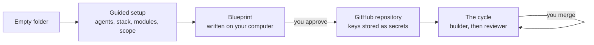

<p align="center">
  <picture>
    <source media="(prefers-color-scheme: dark)" srcset="docs/assets/logo-dark.svg">
    
  </picture>
</p>

<h3 align="center">From an empty folder to a GitHub project that AI agents build, review and ship.<br>You approve every step.</h3>

<p align="center">
  
  
  
  
</p>
<p align="center">
  
  
  
  
</p>
<p align="center">
  
  
  
  
</p>

<p align="center">
  <a href="#install">Install</a> &nbsp;·&nbsp; <a href="#create-a-project">Create a project</a> &nbsp;·&nbsp; <a href="#the-guided-setup">Screens</a> &nbsp;·&nbsp; <a href="#commands">Commands</a> &nbsp;·&nbsp; <a href="#roadmap">Roadmap</a>
</p>

<p align="center">
  
</p>

DEV_OS takes you from an empty folder to a GitHub project that AI agents build task by task. You answer a few
questions in your browser or your terminal, and an AI agent on your computer writes the project's blueprint. When you
approve it, DEV_OS creates the GitHub repository and starts the automated cycle on GitHub Actions. From then on, a
builder agent writes each task, a reviewer agent reviews it, and you merge at the gates.

Status: pre-release `0.1.0`. The repository is private and not licensed for use yet (see `LICENSE`).

## Why DEV_OS

<table>
  <tr>
    <td width="50%" valign="top"><b>Bring the agents you have.</b> Claude Code, Cursor, Codex and Gemini can each review or build. The reviewer can pick the builder whose strengths fit each task.</td>
    <td width="50%" valign="top"><b>A blueprint you approve.</b> Your agent writes the phases, the glossary and the first task into your folder. You approve them or ask for changes, up to five rounds.</td>
  </tr>
  <tr>
    <td width="50%" valign="top"><b>Gates, not guesses.</b> Every task is reviewed against a written fence, a red check overrides a pass, and nothing merges without you.</td>
    <td width="50%" valign="top"><b>Your keys stay yours.</b> Each key is typed once and handed to <code>gh secret set</code> over standard input. It is never stored, logged or shown to a model.</td>
  </tr>
  <tr>
    <td width="50%" valign="top"><b>Lean by default.</b> Choose an MVP or a full product. The first task builds only the skeleton of your stack and makes every check green.</td>
    <td width="50%" valign="top"><b>Any stack it knows.</b> 16 project types and 20 stacks, from Next.js to FastAPI, Go and Flutter, with modules for data, auth, payments, email and more.</td>
  </tr>
</table>

## How it works



## The guided setup

`devos ui my-app` opens the setup as a page on this computer. Every screen below is the real page, captured during a test run with stand-in agents.

<table>
  <tr>
    <td width="50%"><br><sub><b>This computer.</b> The engine, the folder and the AI tools signed in here.</sub></td>
    <td width="50%"><br><sub><b>Builders.</b> Pick models, mark what each is good at, choose the default.</sub></td>
  </tr>
  <tr>
    <td><br><sub><b>Modules.</b> A provider for each part of the product, or None.</sub></td>
    <td><br><sub><b>Review.</b> Your answers, and the keys to get ready.</sub></td>
  </tr>
  <tr>
    <td><br><sub><b>Approve.</b> Read the documents in your editor, then approve or ask for changes.</sub></td>
    <td><br><sub><b>Keys.</b> One at a time, hidden, sent straight to GitHub.</sub></td>
  </tr>
  <tr>
    <td><br><sub><b>GitHub.</b> The repository, its variables and the keys to upload.</sub></td>
    <td><br><sub><b>Done.</b> The first cycle has started.</sub></td>
  </tr>
</table>

## What you get

- **Guided setup, in your browser or your terminal.** It covers the contract, the agents and models for each role,
  eight questions about the project, and optional documents for the agent to read.
- **A blueprint written on your computer** by the agent you choose. It covers:
  - the product brief, scope and decisions;
  - the design system;
  - the data model, when the project stores data;
  - the phases, and the first task (fence T01).

  You approve it or describe the changes you want.
- **A GitHub repository with the whole method installed.** That means the workflows, runner scripts, guards, prompts,
  rules, skills and the operating manual. Every file lives in your repository.
- **Keys typed once.** Each key goes straight to GitHub as a secret. DEV_OS never writes one to a file, a log or a
  model.
- **The automated cycle on GitHub Actions.** For each task:
  - the builder works on a branch;
  - the reviewer checks it against the task's fence;
  - checks run, failed attempts retry, and usage limits are waited out.

  You merge the pull requests.

## Requirements

| What | Why | Check |
|---|---|---|
| Node.js 22 or newer | runs the engine (no dependencies) | `node --version` |
| git | the first local commit | `git --version` |
| GitHub CLI, signed in with the `repo` and `workflow` scopes | creates the repository, sets secrets and variables | `gh auth status` |
| One AI coding CLI, signed in on this computer | writes the blueprint | Claude Code `claude`, Cursor CLI `agent`, Codex CLI `codex` or Gemini CLI `gemini` |
| A key for each tool that runs on GitHub | the reviewer and builders run on GitHub Actions | Cursor: `CURSOR_API_KEY` (cursor.com/dashboard → API keys). Claude Code: `CLAUDE_CODE_OAUTH_TOKEN` (run `claude setup-token`) or `ANTHROPIC_API_KEY`. Codex: `OPENAI_API_KEY` (platform.openai.com → API keys). Gemini: `GEMINI_API_KEY` (aistudio.google.com → API keys) |
| Optional: a Vercel account | deploys | `VERCEL_TOKEN`, `VERCEL_ORG_ID`, `VERCEL_PROJECT_ID`, which you can set later |

`devos doctor` checks the GitHub CLI for you. `devos agents detect` shows which AI CLIs are installed and signed in.

## Install

```
git clone https://github.com/Jovo-Jovi/devos-engine.git
cd devos-engine
npm link
devos --version
```

- **Access.** The repository is private until the release, so you need access to clone it.
- **`npm link`** adds the `devos` command and downloads nothing.
- **Update:** run `git pull` in the clone. **Remove:** `npm uninstall -g devos-engine`.
- **Without `npm link`:** run `node <path to devos-engine>/bin/devos.mjs <command>`.

## Create a project

```
devos doctor
devos init my-app
```

`my-app` must be a new or empty folder. In every menu, type a number (or several, separated by commas) or a name.
Enter takes the default shown.

**In the browser.** `devos ui my-app` runs the same setup as a guided page:

```
devos ui my-app
```

- The page opens in your browser. It runs on this computer only, at `127.0.0.1`, behind a one-time link the
  terminal prints.
- Every answer goes to the same steps as `devos init`, and keys typed on the page reach GitHub the same way.
- Keep the terminal open until the page says it is done. Ctrl-C in the terminal stops the page.

1. **Doctor.** It checks that the GitHub CLI is installed and signed in, and that the token has the scopes it needs.
   When something is missing, it prints the exact command to fix it.
2. **Contract.** Read it, then type `accept`. Anything else stops setup, and nothing is written or sent.
3. **Agents.** Pick a tool and a model for each role:
   - the reviewer, which reviews every task on GitHub;
   - the light reviewer, for low-risk tasks;
   - the builder pool, with each builder's strengths and the default builder;
   - who picks the builder for each task;
   - the blueprint agent, which works on this computer. It can be any signed-in tool.

   The GitHub roles offer Claude Code, Cursor, Codex and Gemini.
4. **Project type, stack and modules.**
   - The project type: SaaS, web app, marketing site, dashboard, marketplace, store, API, mobile, AI product,
     realtime app, documentation site, CLI, library, worker, browser extension or full product.
   - A stack that fits the type: 15 JavaScript and TypeScript stacks, FastAPI, Django, a Python package, Go with chi,
     or Flutter.
   - A provider for each module the type uses: database, storage, auth, payments, email, jobs, search, product AI,
     hosting and observability. Each menu starts on the type's usual choice, and `None` is always offered.
   - The scope: **MVP** (the core flow first; every other feature waits on a "Later" list until you ask for it) or
     **Full product for production** (every feature in your brief, in phases, then a production-readiness phase).
5. **Five questions.** The project name, a one-paragraph brief, who uses it, its languages, and the repository
   visibility (`private` by default). Whether it stores data, the sign-in and the deploy target follow from the
   modules.
6. **Documents (optional).** DEV_OS first lists the documents worth preparing for your type: a product brief or PRD,
   design references, brand assets, content, data and API notes, business rules. Give the paths of the ones you have,
   separated by commas. They are copied to `devos/intake-docs/`. The blueprint reads them, writes every document
   that is still missing, and lists what is left open in `docs/OPEN_QUESTIONS.md`.
7. **Summary.** Check your answers. Confirm, or answer again.
8. **Install.** The method files are written into the folder.
9. **Blueprint.** Your blueprint agent writes the project documents and fence T01 in the folder.
   - A heartbeat line shows it is still working.
   - Ctrl-C stops it and keeps what was written.
   - When it finishes, type `approve`, or describe the changes you want. You get up to five rounds.
10. **Keys.** DEV_OS lists every key this project needs, for the agents and for the modules you picked, and where to
    get each one. Type each one once. The input is hidden, and Enter skips a key you will set later. For a key that is
    a JSON file, such as a service account, give the file's path instead. The values stay in memory until they are
    handed to GitHub (`gh secret set`, over standard input).
11. **GitHub.** DEV_OS shows the plan: the repository, its visibility, the variables, and the keys to upload or set
    later. At `Create it now?`, answer `yes`. DEV_OS then:
    - commits the folder;
    - creates the repository;
    - pushes it;
    - sets the workflow permissions, variables and secrets;
    - runs the setup check;
    - starts the first cycle.

## Lean by default

DEV_OS builds what your brief asks for, nothing cut and nothing added, with the simplest architecture that carries
it.

- **Scope is your choice.** With **MVP**, the first phases ship the core flow end to end and the rest waits on a
  "Later" list in `docs/SCOPE.md`; ask for it with a change request when you are ready. With **Full product for
  production**, every feature is planned in phases, core flow first, and a last phase makes it ready for production:
  a security review, error tracking and logging, backups when data is stored, and the speed of the main pages.
- **The plan cites a need** for every layer, service and dependency it includes.
- **`docs/STACK.md`.** The blueprint writes your stack's current conventions in one page, and every builder follows
  it.
- **Builders** make the simplest change that meets each task, and name every new dependency with the reason for it.
- **Reviewers** fail a task that adds a dependency, abstraction or layer it does not need.
- **Current documentation.** Every agent on GitHub can look up library documentation through Context7, so the code
  follows today's APIs rather than the model's memory.

## After setup

- **The cycle builds T01 on GitHub.** T01 is always the project skeleton from your stack's recipe: the official
  generator, the check commands, one structured logger, error handling, a health route for web and API projects, and
  one architecture test. Every check passes before the first feature. Follow it in the repository's **Actions** and
  **Pull requests** tabs.
- **You merge at the gates.** Each pull request carries a comment from the gate doctor that says what still blocks
  the merge. Comment `/devos doctor` to check again.
- **`SETUP.md`** in the repository lists every setting the project uses. If the setup check reports a missing one,
  add it on GitHub, then run `devos continue my-app`.
- **More work later.** Open a "Dev OS change request" issue in the repository.
- **The operating manual** is `docs/method/AUTOMATION.md` in your project. It covers every workflow, setting,
  comment command and what to do when something goes wrong.

## Stop and resume

- **Pick up where you left off.** `devos continue my-app` prints a checklist: answers, engine files, blueprint
  approved, local commit, repository, keys, first cycle. Each line is marked done (`✓`) or open (`·`), and the first
  open step is finished for you. `devos init --continue my-app` does the same.
- **A repository with the same name already on GitHub.**
  - If it is empty, DEV_OS adopts it and pushes.
  - If it has commits, DEV_OS stops. Delete that repository, or change `"name"` in `devos/answers.json`, then run
    `devos continue my-app`.

  DEV_OS never force-pushes and never rewrites history on GitHub.
- **When the blueprint or a setup step fails,** the message names the cause: for example a usage limit, a trust
  prompt, a model your plan does not include, or a GitHub step. Fix it, then run `devos continue my-app`.

## Commands

| Command | What it does |
|---|---|
| `devos doctor` | Checks the GitHub CLI, its sign-in and its token scopes, and prints the exact fix. It changes nothing. |
| `devos init [folder]` | Guided setup of a new project in an empty folder. |
| `devos ui [folder] [--no-open]` | The same setup as a guided page in your browser, on this computer only. `--no-open` prints the link without opening it. |
| `devos continue [folder]` | Shows what is done and finishes what is missing. |
| `devos status` | In a project folder: shows the project and your saved roster. |
| `devos agents detect` | Lists the AI CLIs on this computer, their versions, and whether each one is signed in. |
| `devos agents show` · `devos agents import <file>` | Shows or saves your default roster of agents (`~/.devos/roster.json`). |
| `devos profile show` · `devos profile set <key> <value>` | Shows or sets your defaults (`~/.devos/profile.json`): `github_owner`, `visibility`, `default_stack`, `cursor_accounts`, `claude_accounts`. It refuses anything that looks like a key. |
| `devos install [folder] --key <KEY>` | Installs the method files only, without the guided setup. |
| `devos upgrade [--local]` | In a project: updates its engine files to this engine's version on a new branch and opens a pull request. Files you changed are listed as conflicts, never overwritten. `--local` commits the branch without pushing. |
| `devos --version` | Prints the engine version. |

## Your keys and data

- **Keys.** DEV_OS never stores a secret value. The keys you type stay in the engine's memory only until each one is
  handed to GitHub over standard input. No model, file, log or answer receives one.
- **Your computer.** The files under `~/.devos/` hold names and choices only.
- **The project.** Your answers are in `devos/answers.json` and your agents are in `devos/project.json`. The method's
  settings are generated into `devos.config.json`; do not edit that file by hand.
- **Reporting.** The contract describes a registry. Registration is not built yet, so nothing is sent to any DEV_OS
  service.

## Current limits

- **GitHub roles.** The reviewer and builders run on Claude Code, Cursor, Codex or Gemini. Codex and Gemini have not yet
  finished a real run on GitHub; the end-to-end test proves them. Muse and GLM can write the blueprint only.
- **Stack.** Every stack runs its own checks: pnpm scripts for JavaScript and TypeScript, uv for Python, go for Go
  and flutter for Dart. Supabase, R2, Firebase and Vercel deploys work with JavaScript and TypeScript stacks for now,
  so a Python, Go or Dart project offers none of them.
- **App keys.** The keys your app reads (payments, email, error tracking, …) are stored as GitHub secrets. Until the
  deploy copies them to your host, also set them in Vercel → Settings → Environment Variables (Production).
- **Testing.** Continuous integration tests the engine on Linux and Windows. The full run on GitHub, from
  `devos init` to a merged first task, gets its end-to-end test before the release.

## Roadmap

1. The design gate for UI projects.
2. Expert prompts, skills and references for each layer of a project.
3. Database, storage and deploys for Python, Go and Dart stacks.
4. The first real run and the end-to-end test, including copying app keys to the host.
5. A link from every project to the DEV_OS Control Tower dashboard.
6. Version 1.0 and its licence.

## Building the engine (maintainers)

The engine is built with its own method. Each task has a fence in `dev/fences/`. Cursor builds it, Claude reviews
it, and the owner commits. The plan is `dev/PLAN.md`, the decisions are `dev/DECISIONS.md`, and the task list is
`dev/LEDGER.md`.

### Layout

```
bin/devos.mjs          the command
lib/                   command internals; lib/data/tools.json lists the AI CLIs and their models
lib/ui/                the guided page that devos ui serves (IBM Plex fonts under the OFL, lib/ui/fonts/OFL.txt)
payload/files/         the method, installed and upgraded (dot-directories are stored as dot-*)
payload/templates/     project-owned starting points, written once at install
payload/contract/      the contract shown by devos init
payload/manifest.json  every engine-owned path with its sha256 (generated: npm run manifest)
tools/                 build-manifest, verify-source, find-specifics, stage
test/                  node:test suites, no dependencies (npm test)
dev/                   plan, decisions, ledger, fences, reports, reviews
```

### One-time setup

```
<workspace>/
├── devos-engine/        this repository
└── devos-sources/
    ├── tower/           Jovo-Jovi/devos-control-tower, pinned at a49ca6d (the method's source)
    └── pilot/           Jovo-Jovi/devos-pilot, pinned at 4ccbef7 (module setup items)
```

From `<workspace>`:

```
git clone https://github.com/Jovo-Jovi/devos-engine.git
git clone https://github.com/Jovo-Jovi/devos-control-tower devos-sources/tower
git -C devos-sources/tower checkout a49ca6db268b98d6558077bf3e95b8ae759d91b3
git clone https://github.com/Jovo-Jovi/devos-pilot devos-sources/pilot
git -C devos-sources/pilot checkout 4ccbef799546315a491da86f4e3676ba46d8fa51
```

### Running a task

Every task is built and reviewed on its own branch, and reaches `main` only after the review of record.

1. **Branch (you).** Run `git switch main`, `git pull`, then `git switch -c task/E16` (the task id).
2. **Build (Cursor).** Open `devos-engine` in Cursor and start a new Agent chat with the model the fence header names.
   The prompt is `Execute dev/fences/E16.md exactly — attempt 1.` The rule `.cursor/rules/00-engine-dev.mdc` binds the
   builder: no git.
3. **Local review (optional, Claude Code).** In `devos-engine`, run `claude`, then `/engine-review E16`. It writes
   `dev/reviews/E16-a1.md`.
4. **Push (you).** Run `git add -A`, `git commit -m "E16 a1: build"`, then `git push -u origin task/E16`. The push
   starts `engine-ci` on Linux and Windows.
5. **Remote review (the review of record).** Tell Claude in the DEVOS project "check task/E16". It runs every
   *Done when* check and writes `dev/reviews/E16-a1-remote.md` on the branch, with MERGE or FIX. It also updates the
   ledger and writes the next fence.
6. **On FIX, or when `engine-ci` is red:** pull the branch, run the next attempt in Cursor (`attempt 2`), and repeat
   from step 4.
7. **Merge (you), after MERGE:**
   ```
   git switch main
   git pull
   git merge --squash task/E16
   git commit -m "<the commit message from the review>"
   git push
   git push origin --delete task/E16
   git branch -D task/E16
   ```
   `main` keeps one commit per accepted task.

If Cursor halts, that is the system working: send its report to the review as it is.
