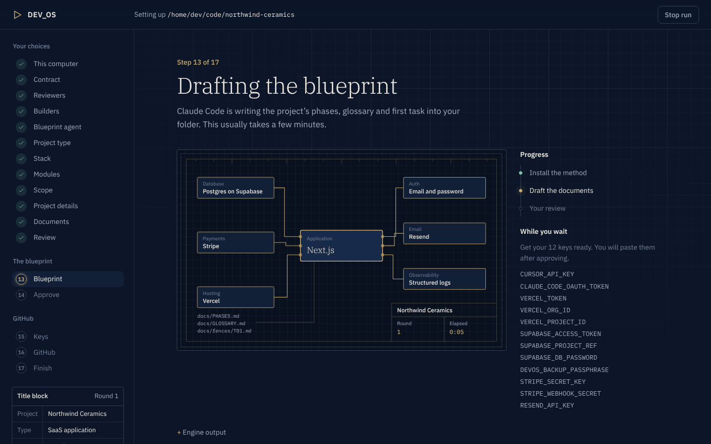
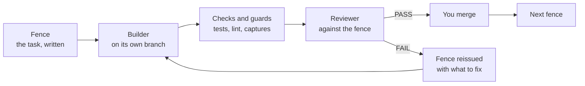
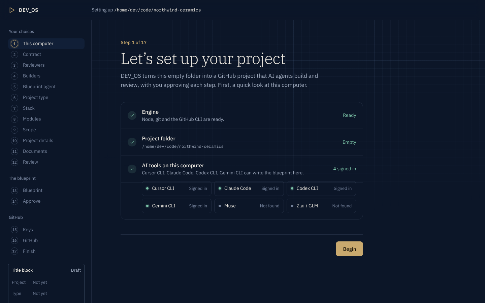
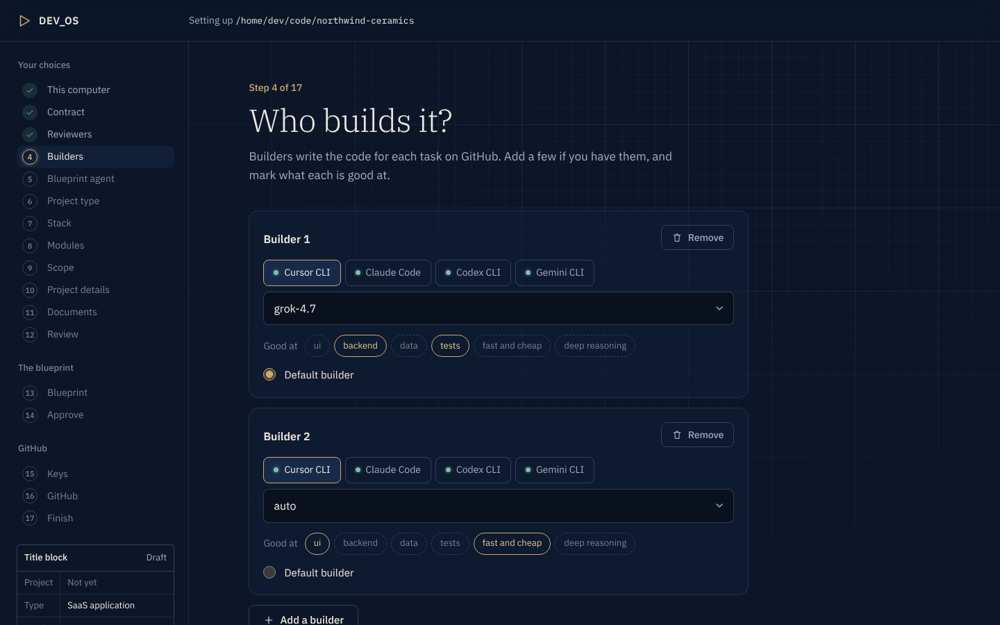
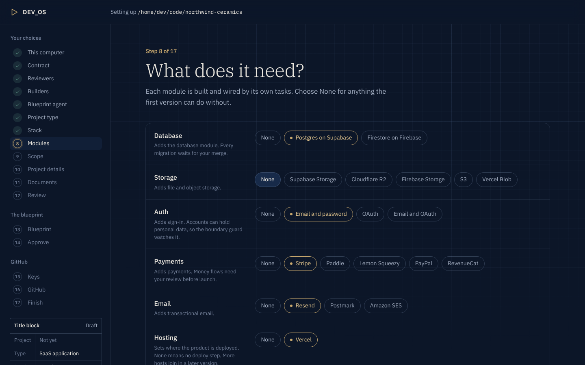
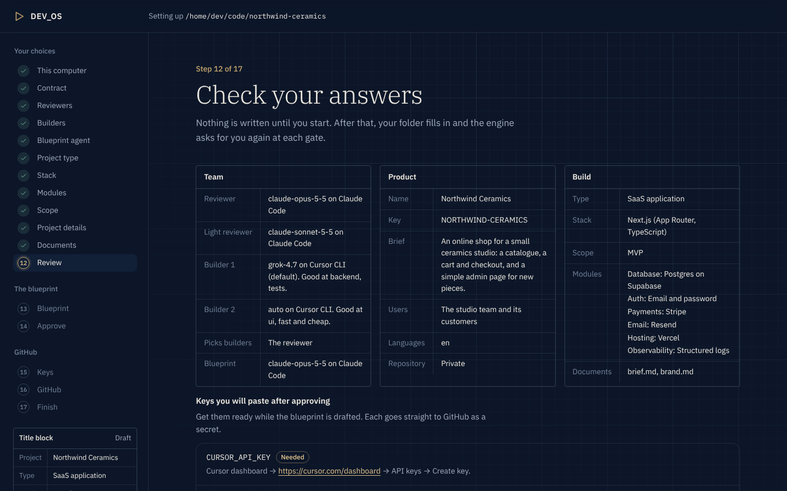
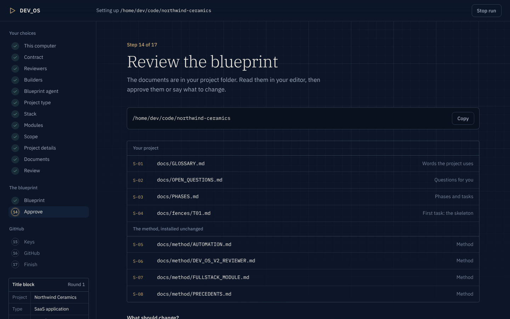
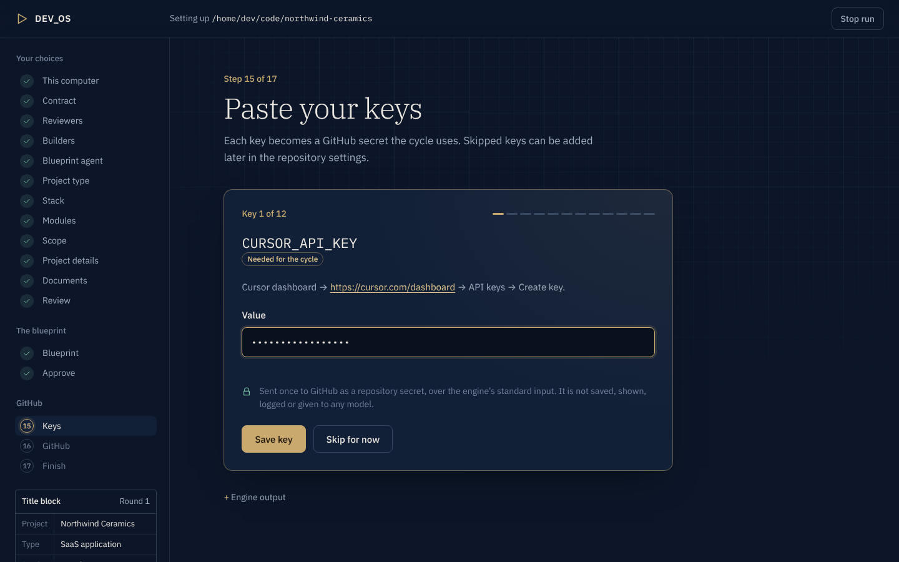
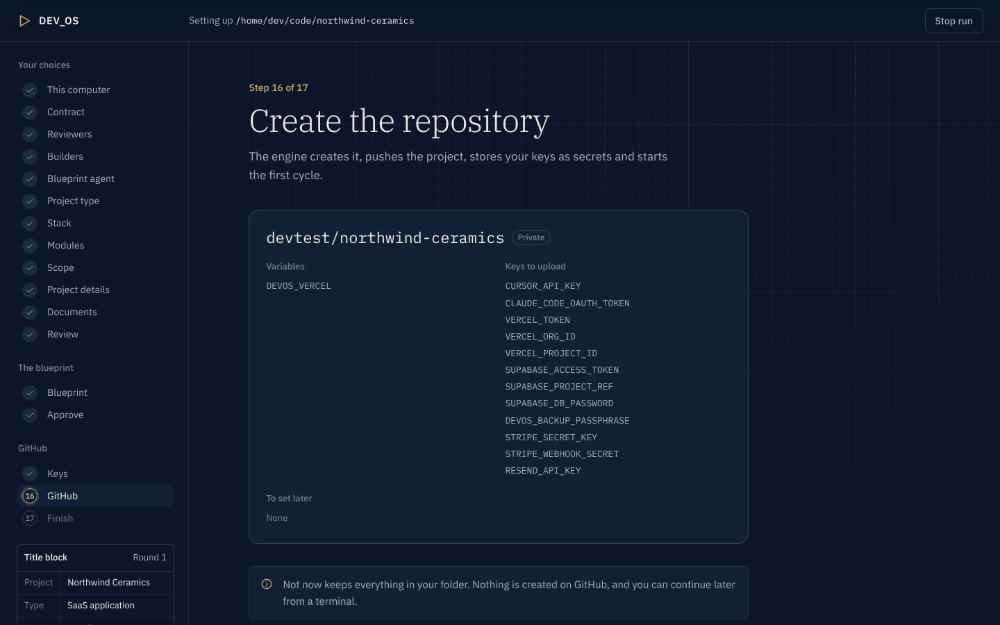
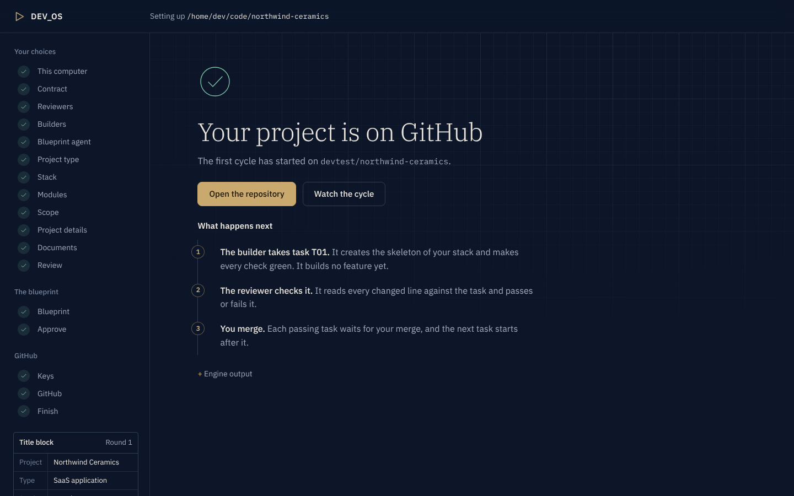

<p align="center">
  <picture>
    <source media="(prefers-color-scheme: dark)" srcset="docs/assets/logo-dark.svg">
    
  </picture>
</p>

<h3 align="center">From an empty folder to a project that AI agents build and review, task by task.<br>You approve every step.</h3>

<p align="center">
  
  
  
  
</p>
<p align="center">
  
  
  
  
</p>
<p align="center">
  
  
  
  
  
</p>

<p align="center">
  <a href="#quick-start">Quick start</a> &nbsp;·&nbsp; <a href="#two-ways-to-build">Two ways to build</a> &nbsp;·&nbsp; <a href="#features-at-a-glance">Features</a> &nbsp;·&nbsp; <a href="#commands">Commands</a> &nbsp;·&nbsp; <a href="#roadmap">Roadmap</a>
</p>

<p align="center">
  
</p>

DEV_OS sets a project up from an empty folder and runs it as small, reviewed tasks. An AI agent on your computer
writes the blueprint: the brief, the scope, the design system, the phases and the first task. You approve it. Each
task is then built from a written fence, checked, reviewed, and merged by you.

Version `1.13.0`. The engine is under PolyForm Shield 1.0.0 and the files it installs into your project under MIT
(see [Licence](#licence)).

## Contents

| Start | Build | Reference |
|---|---|---|
| [Quick start](#quick-start) | [Create a project](#create-a-project) | [Commands](#commands) |
| [Two ways to build](#two-ways-to-build) | [Agents, models and effort](#agents-models-and-effort) | [Settings you can change on GitHub](#settings-you-can-change-on-github) |
| [How a task runs](#how-a-task-runs) | [Types, stacks and modules](#types-stacks-and-modules) | [GitHub minutes and storage](#github-minutes-and-storage) |
| [Features at a glance](#features-at-a-glance) | [After setup](#after-setup) | [Your keys and data](#your-keys-and-data) |
| [Requirements](#requirements) | [Add DEV_OS to a project you have](#add-dev_os-to-a-project-you-have) | [The Control Tower (optional)](#the-dev_os-control-tower-optional) |
| [Install](#install) | [Stop and resume](#stop-and-resume) | [Limits](#current-limits) · [Roadmap](#roadmap) · [Licence](#licence) · [Security](#security) |

## Quick start

```
git clone https://github.com/Jovo-Jovi/devos-engine.git
cd devos-engine
./devos ui
```

On Windows, double-click `Start DEV_OS.cmd`; on macOS, `Start DEV_OS.command`. The setup opens in your browser:

1. **This computer.** The page checks the engine, git, the GitHub CLI and the AI tools signed in.
2. **How it is built.** Automated on GitHub, or local on this computer ([Two ways to build](#two-ways-to-build)).
3. **The questions, then the blueprint.** Your agent writes the documents; you read them and approve.

Before a first project, read [Before you start a project](docs/PROJECT-CHECKLIST.md): every decision, file and key the
setup asks for, in order, with a worksheet.

## Two ways to build

|  | Automated development (GitHub) | Local development (this computer) |
|---|---|---|
| **Builds each task** | The builder agent, on GitHub Actions | You, your own way, from the plan and the first task's fence: DEV_OS hands the project over after the blueprint |
| **Reviews each task** | The reviewer agent, on GitHub Actions | You; `devos adopt` brings DEV_OS's agents back later, from the first task left open |
| **Merges** | You, at the gates | You |
| **Needs** | Node.js 22, git, the GitHub CLI signed in, a key for each agent tool | Node.js 22 and git |
| **Setup ends with** | The repository on GitHub, keys as secrets, the first cycle started | The approved blueprint, `README.md`, `SETUP.md` and the first commit, without DEV_OS's scripts, guards, workflows or agent settings (`docs/method/` stays) |
| **GitHub** | Required | Optional: a private backup that holds the project; nothing runs there |
| **Start** | `devos init <folder>` | `devos init --local <folder>` |
| **Check this computer** | `devos doctor` | `devos doctor --local` |

The guided page asks the same choice on its first screen. `devos init --help` explains both.

## How a task runs



- **A fence** is the task's contract: the paths it may touch, its steps, the commands that prove it is done, and what
  it must not do.
- **A red check overrides a PASS.** Nothing merges while a check is red.
- **You merge at the gates.** A migration, a new sign-in or payment import, and every gate task stop for a person.
- **Usage limits are waited out:** on a second account, then the next model, then a builder of another tool, and only
  then until the earliest reset, hours or days away.

## Features at a glance

| Area | What you get |
|---|---|
| **Guided setup** | A page (`devos ui`) or the terminal (`devos init`). A new project starts from your last choices. |
| **Blueprint** | Brief, scope, decisions, design system, data model, phases, fence T01 and the product's `README.md`, written on your computer. Up to five rounds of changes. |
| **Design from references** | Your reference images become a direction of the project's own, never a copy. Every UI fence has a design specification. |
| **Visual ambition and media** | Calm, Expressive or Showcase sets the direction. With generated media, the blueprint plans every image, video and voice item before a screen shows it; images you own are shown as they are. |
| **The cycle** | 11 workflows on GitHub Actions: build, checks, review, change requests, the next task, gates, setup, deploys, waits, a supervisor. |
| **Agents** | Claude Code, Cursor, Codex and Gemini, each as reviewer or builder. The reviewer can pick the builder for each task. |
| **Effort** | Set per agent: chosen by the reviewer for each task, or fixed, with Fast for Cursor. |
| **Usage limits** | Second accounts, up to 4 next models per role, a fallback builder of another tool. |
| **Guards** | 18 guards on every task, from scope and secrets to design, i18n, data boundaries, the media plan and new dependencies. |
| **Launch gate** | The last task before launch checks the main pages' security headers, accessibility and speed, and audits every dependency. The reviewer verifies the OWASP ASVS and a production checklist per layer. A failed check waits for a fix or your written waiver. |
| **UI evidence** | Captures at 1280 and 390 px, filmstrips, reduced motion, layout shift and axe checks, read against the design specification. |
| **Lean by default** | MVP or full product; every dependency names its need; current library docs through Context7. |
| **Expert skills** | 20 vendored skill sets, chosen for the stack and modules. |
| **Product README** | Written by the blueprint, kept current by every feature task, never deleted. |
| **Usage and cost** | Tokens per agent run, totalled in `docs/USAGE.md` by model, stage and task. |
| **Adopt and upgrade** | Add DEV_OS to a project you have, and take new engine versions, each by pull request. |
| **Project page** | A project's setup, versions, models and link, with upgrade and connect buttons. |
| **Control Tower link** | Optional, off unless you answer yes ([details](#the-dev_os-control-tower-optional)). |

## Requirements

| What | Why | Check |
|---|---|---|
| Node.js 22 or newer | runs the engine (no dependencies) | `node --version` |
| git | the project's commits | `git --version` |
| One AI coding CLI, signed in on this computer | writes the blueprint | Claude Code `claude`, Cursor CLI `agent`, Codex CLI `codex` or Gemini CLI `gemini` |
| **Automated only:** the GitHub CLI, signed in with the `repo` and `workflow` scopes | creates the repository, sets secrets and variables | `gh auth status` |
| **Automated only:** a key for each tool that runs on GitHub | the reviewer and builders run on GitHub Actions | see below |
| Optional: a Vercel account | deploys | `VERCEL_TOKEN`, `VERCEL_ORG_ID`, `VERCEL_PROJECT_ID`, which you can set later |
| Optional: an xAI API key | generated media | `DEVOS_MEDIA_XAI_KEY`, used only when `DEVOS_MEDIA_BUDGET` is above 0 |

| Tool | Key on GitHub | Where to get it |
|---|---|---|
| Cursor | `CURSOR_API_KEY` | cursor.com/dashboard → API keys |
| Claude Code | `CLAUDE_CODE_OAUTH_TOKEN` or `ANTHROPIC_API_KEY` | run `claude setup-token` |
| Codex | `OPENAI_API_KEY` | platform.openai.com → API keys |
| Gemini | `GEMINI_API_KEY` | aistudio.google.com → API keys |

`devos doctor` checks the GitHub CLI for you, and `devos agents detect` shows which AI CLIs are installed and signed in.

## Install

1. **Install the requirements** above.
2. **Get the engine.** Clone it, or download the ZIP of a release and unzip it anywhere. `CHANGELOG.md` says what each
   release changed.
3. **Start it.** Nothing else to install.

| Where | Start the guided setup |
|---|---|
| Windows | double-click `Start DEV_OS.cmd` |
| macOS | double-click `Start DEV_OS.command` (the first time: right-click it, then **Open**) |
| macOS or Linux terminal | `./devos ui` |
| Windows PowerShell | `.\devos ui` |
| Windows Command Prompt | `devos ui` |
| Any shell | `node bin/devos.mjs ui` |

- **Where projects go.** Each project gets its own new folder outside the engine folder. The page suggests
  `devos-projects` in your home folder.
- **Update the engine** with `git pull` in its folder, or a new ZIP. Your projects change only when you run
  `devos upgrade` in one.
- **`devos` in any folder (optional).** Run `npm link` once in the engine folder. If `devos` is still not found, add
  npm's global folder to your PATH: the folder `npm prefix -g` prints on Windows, its `bin` on macOS and Linux.

## Create a project

<table>
  <tr>
    <td width="50%"><br><sub><b>This computer.</b> The engine, the folder and the AI tools signed in here.</sub></td>
    <td width="50%"><br><sub><b>Builders.</b> Pick models, mark what each is good at, choose the default.</sub></td>
  </tr>
  <tr>
    <td><br><sub><b>Modules.</b> A provider for each part of the product, or None.</sub></td>
    <td><br><sub><b>Review.</b> Your answers, and the keys to get ready.</sub></td>
  </tr>
  <tr>
    <td><br><sub><b>Approve.</b> Read the documents in your editor, then approve or ask for changes.</sub></td>
    <td><br><sub><b>Keys.</b> One at a time, hidden, sent straight to GitHub.</sub></td>
  </tr>
  <tr>
    <td><br><sub><b>GitHub.</b> The repository, its variables and the keys to upload.</sub></td>
    <td><br><sub><b>Done.</b> The first cycle has started.</sub></td>
  </tr>
</table>

The page and `devos init` ask the same questions, in this order. The page runs on `127.0.0.1` only, behind a one-time
link the terminal prints, and follows your light or dark setting. In the terminal, type a number, several separated by
commas, or a name; Enter takes the default.

| # | Step | What happens |
|---|---|---|
| 1 | **Doctor** | Checks the tools this way of building needs, and prints the exact fix for anything missing. |
| 2 | **Contract** | Read it and accept it. Anything else stops setup; nothing is written or sent. |
| 3 | **Agents** | A tool and model for the reviewer, the light reviewer, the builder pool and the blueprint agent, and each one's effort ([Agents, models and effort](#agents-models-and-effort)). |
| 4 | **Type, stack, modules, scope** | One of 16 types, a stack that fits it, a provider (or None) for each module, **MVP** or **Full product for production**, and for a product with screens its visual ambition ([Types, stacks and modules](#types-stacks-and-modules)). |
| 5 | **Five questions** | The name, a one-paragraph brief, who uses it, its languages, and the repository's visibility (`private` by default). |
| 6 | **Documents (optional)** | The documents worth preparing for your type. Give the ones you have; the blueprint writes the rest and lists what is open in `docs/OPEN_QUESTIONS.md`. |
| 7 | **Summary** | Check your answers, then confirm or answer again. |
| 8 | **Install** | The method's files are written into the folder. |
| 9 | **Blueprint** | Your agent writes the documents and fence T01. Approve them, or describe the changes (up to five rounds). |
| 10 | **Keys** (automated) | Every key the project needs, and where to get it. Each is typed once, hidden, and handed to `gh secret set`. |
| 11 | **GitHub** (automated) | Commits, creates the repository, pushes, sets permissions, labels, variables and secrets, runs the setup check and starts the first cycle. |
| 10–11 | **Local** | `SETUP.md` and the first commit, then one question: a private GitHub backup, yes or no. |

<details>
<summary><b>Documents you can give, and their limits</b></summary>

- **Documents:** a product brief or PRD, brand assets, content, data and API notes, business rules. Markdown, text,
  CSV, JSON or YAML up to 1 MB, or PDF up to 20 MB. They are copied to `devos/intake-docs/`.
- **Design references:** images of designs you like, PNG, JPEG, WebP or GIF, up to 20 MB each, 30 files and 200 MB in
  all. They are kept in `docs/design/references/`, and the blueprint lists each one in `docs/design/REFERENCES.md`.
- **Images you own** (a project with screens): your logo, product or team photos, PNG, JPEG, WebP or GIF, counted
  with the files above. They are kept as they are in `docs/design/own/`, the media plan lists each one, and the
  cycle (or `devos media`) places it where the product serves it: free, with no key, and with or without generated
  media.
- **Names:** name each file for what it holds (`brief.md`, `brand-guide.pdf`) and each image for what it shows
  (`ref-checkout-stripe.png`, `logo.png`). The agents cite them by name.

</details>

<details>
<summary><b>While the blueprint is written</b></summary>

- With Cursor and Claude Code, the page shows each step as the agent takes it: the file it reads or writes, the
  command it runs.
- When a check of the documents fails, the agent fixes only what failed, in the same session.
- A round with no progress for 15 minutes is stopped. Documents that pass the checks go to your review; otherwise the
  agent fixes what fails.
- Stopping keeps what was written.

</details>

## Agents, models and effort

| Role | Runs | What it does |
|---|---|---|
| **Reviewer** | on GitHub (automated) | Reviews every task against its fence, deeply for risk 3 and gates. |
| **Light reviewer** | on GitHub (automated) | Reviews low-risk tasks. |
| **Builder pool** | on GitHub (automated) | Builds each task. Each builder has strengths (UI, motion, accessibility, i18n, backend, data, security, devops, tests, docs, fast and cheap, deep reasoning) and one is the default; you choose who picks the builder for each task. |
| **Blueprint agent** | on this computer | Writes the blueprint. Any signed-in tool. |

| Setting | How |
|---|---|
| **Models** | Only the models a tool lists for your account are offered. |
| **Effort** | The blueprint agent runs at high by default; Claude Code also takes Max. A builder's effort is chosen by the reviewer in each fence, or fixed, with Fast for Cursor. |
| **A model for the next run** | `devos models set <role> <model>` or the page's **Models** button; same tool, no commit. |
| **Next models at a limit** | Up to 4 per role, of its own tool (`devos models fallback`, by pull request). A model the account cannot use is skipped. |
| **Another tool for a role** | `devos models tool` or the page's **Another tool**, by pull request, once the repository has that tool's key. |
| **Second accounts** | `CURSOR_API_KEY_2`, `CLAUDE_CODE_OAUTH_TOKEN_2`, `OPENAI_API_KEY_2`, `GEMINI_API_KEY_2`: at a limit the run continues on the other account. |
| **Fallback builder** | `agents.fallback_builder` in `devos/project.json`: a builder of another tool finishes the task when the default's tool is out for longer than a run waits. |

## Types, stacks and modules

- **16 project types:** SaaS, web app, marketing site, dashboard, marketplace, store, API, mobile, AI product,
  realtime app, documentation site, CLI, library, worker, browser extension and full product.
- **20 stacks, each with its own checks:** Next.js, Nuxt, SvelteKit, Remix, Astro, Astro Starlight, Vite + React,
  Vite + Vue, SolidStart, Hono, Fastify, NestJS, Expo, a Node TypeScript bin or package, FastAPI, Django, a Python
  package, Go with chi, and Flutter.
- **Scope:** **MVP** ships the core flow first and keeps the rest on a "Later" list in `docs/SCOPE.md`; **Full product
  for production** plans every feature in phases, then a production-readiness phase.

| Module | Providers (each menu also offers None) |
|---|---|
| Database | Postgres on Supabase, Firestore on Firebase |
| Storage | Supabase Storage, Cloudflare R2, Firebase Storage, S3, Vercel Blob |
| Auth | Email and password, OAuth, both |
| Payments | Stripe, Paddle, Lemon Squeezy, PayPal, RevenueCat |
| Email | Resend, Postmark, Amazon SES |
| Jobs | Upstash Redis, BullMQ |
| Search | Postgres full text, Meilisearch |
| Product AI | Chat, tools and agents, retrieval |
| Hosting | Vercel |
| Observability | Structured logs, Sentry |
| Generated media | xAI (Grok Imagine and text to speech): images, video or voice. The blueprint plans each item in `docs/design/media.json`; the cycle (or `devos media`) makes them within a budget you set (0 by default) |

Each menu starts on the type's usual choice. A migration always waits for your merge. A product with screens also
chooses its **visual ambition**: Calm (content first), Expressive (imagery and motion where they serve, the default) or
Showcase (hero media, rich motion and depth).

## After setup

- **T01 is the skeleton.** It comes from your stack's recipe: the official generator, the check commands, one
  structured logger, error handling, a health route for web and API projects, and one architecture test. Every check
  passes before the first feature.
- **Follow the cycle** in the repository's **Actions** and **Pull requests** tabs, or with `devos watch <folder>`.
- **When a run fails,** `devos verify <folder>` quotes it, names the likely cause and the fix, and says who applies it.
- **Each pull request** carries the gate doctor's comment: what still blocks the merge. Comment `/devos doctor` to
  check again.
- **More work later:** open a "Dev OS change request" issue in the repository.
- **`SETUP.md`** lists every setting the project uses. After adding a missing one on GitHub, run
  `devos continue <folder>`.
- **The operating manual** is the project's `docs/method/AUTOMATION.md`: every workflow, setting, comment command, and
  what to do when something goes wrong.

<details>
<summary><b>A project's page: upgrade and connect</b></summary>

- **Open it.** Start DEV_OS and choose **Current project**: pick a project from your projects folder, choose its
  folder, or paste its GitHub address (your gh account must own or administer it). Opening a project changes nothing.
- **It shows** the project's setup, its version next to this engine's and the latest release, its models and its
  Control Tower link.
- **Upgrade by pull request** when the project is older than this engine. Merge it on GitHub, then press **Bring this
  folder up to date**.
- **Connect by pull request** once the engine, the project and the latest release are the same version: a pull request
  records your answer, and `DEVOS_REPORTING` turns on. A link run then asks the Control Tower, and its operator approves
  once. **Ask the Control Tower now** asks again.
- **A new contract version** shows on the page: read it and press **Accept by pull request**.

</details>

<details>
<summary><b>Engine updates</b></summary>

Run `git pull` in the engine folder, then `devos upgrade` in the project folder, on `main` with nothing uncommitted.
DEV_OS opens a pull request with every engine file that changed; merge it, and the next cycle runs with the update. A
file you edited yourself is listed as a conflict and never overwritten. Your code, your documents,
`devos/project.json` and `devos/prices.json` are never touched.

</details>

## Add DEV_OS to a project you have

From the project's own clone on GitHub, in development or in production:

| Step | Command | What happens |
|---|---|---|
| 1. Survey | `devos adopt --check` | Reads tracked files only and reports the stage, stack, services, workflows, deploys, an older DEV_OS copy, the files DEV_OS would overlap, and what stops it. Changes nothing. |
| 2. Brief | `devos adopt` | Your own AI tool writes a brief of the project, working on a copy in `~/.devos/adopt/`, never in the project. Type `yes` to keep it, or say what to change. |
| 3. Install | `devos adopt --install` | Adds DEV_OS on a new branch `devos/adopt`, in one commit, in a separate worktree. Your code, CI and files stay; the guards' findings on your code as it is become the baseline. |
| 4. Publish | `devos adopt --publish` | Pushes the branch and opens its pull request once you type `yes`, and sets the keys, variables and labels. No cycle starts until you merge. |

An older hand-copied DEV_OS keeps its documents and settings; its method files become the engine's. It is adopted only
while no task branch is open and no cycle runs.

A project DEV_OS handed over (`devos init --local`) comes back without an AI tool: its brief comes from its own plan,
the tasks you ticked as built are accepted after your yes, and the cycle resumes from the first open task, whose fence
must be committed.

## Stop and resume

- **Stop** with **Stop run** on the page, or Ctrl-C. The folder keeps what was written.
- **Right after a stop or an error,** the page offers **Continue**, another blueprint agent, a new project, or
  **Close DEV_OS**.
- **Later,** start DEV_OS and choose **Current project**: each project shows the step it picks up at. Or run
  `devos continue <folder>`, which prints the checklist (`✓` done, `·` open) and finishes the first open step.
- **A blueprint already written** is not drafted again.
- **A repository with the same name on GitHub:** an empty one is adopted and pushed; one with commits stops setup.
  Delete it, or change `"name"` in `devos/answers.json`, then continue. DEV_OS never force-pushes or rewrites history.

## Commands

| Command | What it does |
|---|---|
| `devos ui [folder] [--no-open]` | The guided setup as a page in your browser, on this computer only. |
| `devos init [--local] [folder]` | The guided setup in the terminal. `--local`: local development. `--help` explains both ways. |
| `devos init --plan <file> [folder]` | Setup from a plan file, as the page does. |
| `devos continue [folder]` | Shows what is done and finishes what is missing (also `devos init --continue`). |
| `devos doctor [--local]` | Checks the GitHub CLI, its sign-in and scopes; `--local`, Node.js 22 and git. Changes nothing. |
| `devos verify [folder]` | Checks everything between this computer and a green cycle run, and quotes a failed run. Changes nothing. |
| `devos watch [folder] [--interval <s>] [--once]` | Runs `devos verify` every 30 seconds until all is green. |
| `devos media [folder] [--budget <usd>] [--only <id,…>] [--yes]` | Makes the project's planned media with the key in your shell (`DEVOS_MEDIA_XAI_KEY`). Without `--budget` it only estimates; with one it asks before it pays. It never commits. |
| `devos adopt [folder] [--install \| --publish] [--agent <tool>[:<model>]]` | Adds DEV_OS to a project you have ([steps](#add-dev_os-to-a-project-you-have)). |
| `devos adopt --check [folder] [--json]` | The read-only survey of a project you have. |
| `devos upgrade [--local]` | Updates the project's engine files on a new branch and opens a pull request; `--local` commits without pushing. |
| `devos remove [folder] [--local]` | Takes DEV_OS out of a project: removes the files it installed and still owns on a branch `devos/remove` and opens a pull request (`--local`: a commit only), keeping your documents, fences, reviews, `docs/method/` and any DEV_OS file you edited. Run again after the merge, it deletes DEV_OS's secrets, `DEVOS_*` variables and `devos:` labels on GitHub after you type yes, and a never-merged `devos/adopt` branch. |
| `devos models [folder]` | The reviewer's, the light reviewer's and the default builder's model. |
| `devos models set <role> <model>` · `reset <role>` | Sets or clears the role's model variable for the next run. Roles: `reviewer`, `light`, `builder`. |
| `devos models fallback <role> <model,…\|none>` | Opens a pull request with the role's next models (up to 4). |
| `devos models tool <role> <tool> <model>` | Opens a pull request that moves the role to another tool (`cursor`, `claude`, `codex`, `gemini`) and model, once the repository has its key. |
| `devos agents detect` | Lists the AI CLIs here, their versions, and whether each is signed in. |
| `devos agents show` · `import <file>` | Shows or saves your default roster (`~/.devos/roster.json`). |
| `devos profile show` · `set <key> <value>` | Your defaults (`~/.devos/profile.json`). It refuses anything that looks like a key. |
| `devos status` | In a project: the project and your roster. |
| `devos install [folder] --key <KEY>` | Installs the method's files only, without the guided setup. |
| `devos help` · `devos --version` | The commands, and the engine's version. |

## Settings you can change on GitHub

Each project reads these repository variables at the start of every run. Set them on GitHub (the repository →
Settings → Secrets and variables → Actions → **Variables**), or with
`gh variable set <NAME> --body <value> --repo <owner>/<repo>`. A variable that is not set takes its default, and a
change applies from the next run. The project's `docs/method/AUTOMATION.md` lists every one (section 8).

| Variable | Default | What it does |
|---|---|---|
| `DEVOS_PAUSED` | `false` | `true` stops every `devos-*` workflow, schedules included; `ci` still checks each push to `main`. |
| `DEVOS_SUPERVISOR` | `on` | `off` stops the supervisor only; the cycle keeps running. |
| `DEVOS_HEAVY` | `notify` | `hold`: a heavy run waits until you comment `/devos go`. |
| `DEVOS_CURSOR_ACCOUNT`, `DEVOS_CLAUDE_ACCOUNT`, `DEVOS_CODEX_ACCOUNT`, `DEVOS_GEMINI_ACCOUNT` | `1` | The account, 1 or 2, each tool starts with. Account 2 needs its `_2` key. |
| `DEVOS_ACCOUNT_SWITCH` | `auto` | At a usage limit, `auto` goes on with the other account; `off` keeps to the one chosen. |
| `DEVOS_REVIEWER_MODEL`, `DEVOS_REVIEWER_LIGHT_MODEL`, `DEVOS_BUILDER_MODEL` | not set | A role's model, with the same tool (`devos models`). Not set: the configured model. |
| `DEVOS_SCREENS_RETENTION_DAYS` | `3` | How many days GitHub keeps a cycle run's screenshots. |
| `DEVOS_REPORTING` | not set (off) | `on` links the project to the Control Tower: your answer at setup. |
| `DEVOS_STATE` | `on` | With the link on, the project's state is sent twice a day; `off` stops it. |
| `DEVOS_MEDIA_BUDGET` | not set (0) | The most one cycle run may spend making the media its fence names. 0 only estimates. |
| `DEVOS_VERCEL`, `DEVOS_SUPABASE`, `DEVOS_R2`, `DEVOS_FIREBASE` | not set | `true` turns on the deploy and that module's steps. Setup sets the ones you chose. |
| `DEVOS_PREVIEW_DB` | not set | `true`: with the database module, each preview gets its own database. |

## GitHub minutes and storage

- **Public or private.** GitHub Actions runs public repositories at no cost. A private repository uses your plan's
  monthly minutes and artifact storage: on GitHub Free, 2,000 minutes and 0.5 GB a month. When they run out, GitHub
  stops its workflows until the month resets, or bills the extra if your account has a payment method. See [How use of
  GitHub Actions is measured](https://docs.github.com/en/billing/concepts/product-billing/github-actions).
- **What uses them.** Minutes: each task's builder and reviewer, often 30 minutes or more each; `ci` on every push; the
  supervisor and resume schedules. Storage: each run's evidence, mostly screenshots.

<details>
<summary><b>Keep them low</b></summary>

- Pause a project you are not working on: `gh variable set DEVOS_PAUSED --body true --repo <owner>/<repo>`.
- Screenshots are kept 3 days (`DEVOS_SCREENS_RETENTION_DAYS`); the rest follows the repository's **Artifact and log
  retention** (Settings → Actions → General), 90 days unless you change it.
- Delete old artifacts from a run's page, or with `gh api -X DELETE repos/<owner>/<repo>/actions/artifacts/<id>`.
- Your usage is on Settings → Billing → Usage. Storage counts by the hour, so deleting artifacts stops more usage but
  does not lower what the month has used.

</details>

## Your keys and data

- **Keys.** DEV_OS never stores a secret value. The keys you type stay in the engine's memory only until each one is
  handed to GitHub over standard input. No model, file, log or answer receives one.
- **Your computer.** The files under `~/.devos/` hold names and choices only, such as `choices.json`, the choices of
  your last project (never a key, a name or a brief).
- **The project.** Your answers are in `devos/answers.json` and your agents in `devos/project.json`. The method's
  settings are generated into `devos.config.json`; do not edit that file by hand.
- **The Control Tower.** Nothing is sent anywhere unless you answer yes to the link question at setup.

## The DEV_OS Control Tower (optional)

- **What it is.** A private service operated by Jovo-Jovi, separate from the engine. It is not a public dashboard and
  not a service engine users get: you have no access to it, and nothing in the engine needs it.
- **Your choice.** Right after you accept the contract, setup asks whether to link the project, with no answer chosen
  for you.
  - **No:** nothing is ever sent, and every feature works the same.
  - **Yes:** the project's cycle asks the Control Tower to link the repository, and its operator approves or declines.

<details>
<summary><b>What a link sends, what is kept, where, and your rights</b></summary>

- **What a link sends.**
  - The request: its format version, the proposed project key, the engine version and the contract version, with
    GitHub's signed identity token for the workflow run. The Control Tower keeps only the repository and its owner's
    numeric GitHub id from that token, and drops the token.
  - After approval, one event per cycle step: its format version, the project key, the run, a sequence number, the
    phase, the task, the step, its status, the time and the evidence file's path and commit.
  - After approval, a link run also sends the project's plan with the same fields: one event for each task of
    `docs/PHASES.md`, finished or still to do, so the Control Tower shows every task and the current phase.
  - Never your code, diffs, prompts, file contents, secrets, keys, emails or token counts.
- **How.** HTTPS to `https://devos-control-tower.vercel.app`, from the cycle's `report` job only.
  - That job runs no AI agent, holds no key, and alone gets GitHub's `id-token: write` permission to prove which
    repository is asking.
  - No token is stored, and reporting never blocks a run.
- **What it keeps, and for how long.** The operator, Jovo-Jovi, alone reads it.
  - From each request: the repository's full name, the owner's numeric GitHub id, the proposed key, the versions and
    the request and decision times. After approval, the project's step events.
  - A pending or declined request: up to 180 days after its last request. A disconnected project with its events: up
    to 365 days after the decision. A linked project: while it stays linked. Encrypted backups: up to 30 days after a
    deletion.
- **Where.** Supabase in Frankfurt, Germany (`eu-central-1`), and Vercel in Frankfurt (`fra1`); requests can pass
  through Vercel's network in other countries, and the encrypted backups are kept on GitHub. All three companies are
  based in the United States.
- **Changing your mind.** The repository variable `DEVOS_REPORTING` is `on` when you answered yes. Set it to `off`, or
  delete it, and nothing more is sent from the next run on.
- **Your rights.** To know what is kept about you, to get a copy, or to have it corrected or deleted, write to
  jiovanny.adel@gmail.com.

</details>

## Current limits

- **GitHub roles.** Codex and Gemini have not yet finished a real run on GitHub; Muse and GLM can write the blueprint
  only.
- **Stacks.** Supabase, R2, Firebase and Vercel deploys work with JavaScript and TypeScript stacks for now, so a
  Python, Go or Dart project offers none of them.
- **App keys.** The keys your app reads (payments, email, error tracking, …) are stored as GitHub secrets. Until the
  deploy copies them to your host, also set them in Vercel → Settings → Environment Variables (Production).
- **Local mode** sets the project up and leaves building and reviewing to your IDE and your reviewer; the engine has no
  local runner yet.
- **Testing.** Continuous integration tests the engine on Linux on every change, and on Windows before each release.
  The full run on GitHub, from `devos init` to a merged first task, has no end-to-end test yet.

## Roadmap

| Next | What it adds |
|---|---|
| Media inside products | Image, voice and video features for a product's own users, as Product AI providers. |
| Local commands | `devos next` and `devos review` for IDE builds, then an automatic local runner, `devos run`. |
| From local to GitHub | `devos cycle github` moves a local project onto the automated cycle. |
| More stacks with modules | Database, storage and deploys for Python, Go and Dart stacks. |
| End-to-end test | The first full run on GitHub, tested, including copying app keys to the host. |

## Licence

- **The engine**, meaning the `devos` command, its guided page and the contract, is under the
  [PolyForm Shield License 1.0.0](LICENSE). You may use it for any purpose, commercial work included, except to
  provide a product that competes with it, or with a product its licensor provides using it. The text in `LICENSE`
  is what binds.
- **The files DEV_OS installs into your project** are under the MIT License, in `devos/LICENSE.md` of every project.
  Your project may keep, change and ship them under its own licence, with that notice.
- **Third-party files keep their own licences:** the vendored skills under `devos/skills/` (MIT, Apache-2.0,
  CC-BY-4.0 and CC-BY-SA-4.0) and the IBM Plex fonts of the guided page (OFL-1.1). See
  [THIRD_PARTY_NOTICES.md](THIRD_PARTY_NOTICES.md).
- [LICENSES.md](LICENSES.md) maps every file to its licence, and [CHANGELOG.md](CHANGELOG.md) lists what each
  release changed.

## Security

Report a vulnerability privately, never in a public issue: see [SECURITY.md](SECURITY.md).
